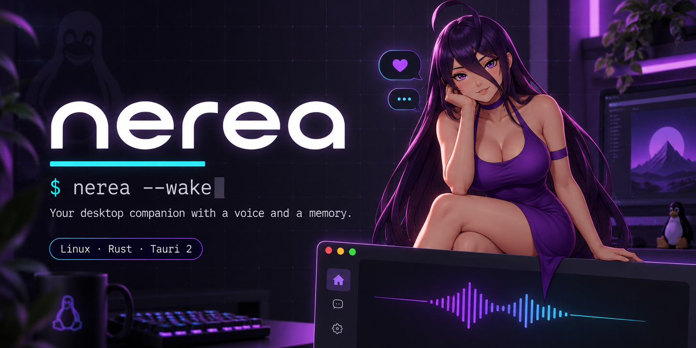
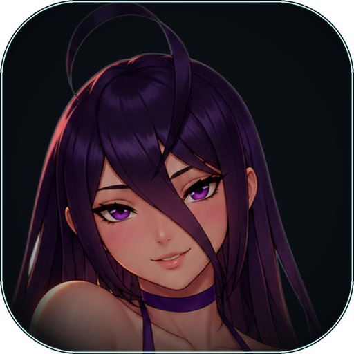

<p align="center">
  
</p>

<p align="center">
  <a href="#quick-start"></a>
  
  
  
  
</p>

<p align="center">
  
</p>

Nerea lives on your desktop as a single portrait. Click her and a chat opens attached to
her body; close it and she goes back to being a small figure sitting on the corner of your window.
Her text is Spanish, her voice is Japanese, and she remembers the conversation after a restart.

Rust core, Tauri 2 shell, static art. No Electron, no WebGL, no JavaScript in the brain.

---

## Contents

- [What she does](#what-she-does)
- [Architecture](#architecture)
- [Quick start](#quick-start)
- [Memory](#memory)
- [Providers](#providers)
- [Voice](#voice)
- [Commands](#commands)
- [Versions](#versions)
- [Design decisions](#design-decisions)
- [Known gaps](#known-gaps)
- [Conventions](#conventions)

---

## What she does

<p align="center">
  
</p>

**One window, two shapes.** Her portrait is `176 × 256`; the chat panel grows the same window up and
to the left, keeping her feet exactly where they were. Nothing else opens on launch.

| | |
|---|---|
| **Interaction** | click her to open the chat, `✕` to close it, drag her to move, right-click for the menu, `Esc` to close |
| **Reactions** | 15 single-frame expressions: `idle`, `tease`, `jealous`, `flirt`, `affection`, `laugh`, `surprise`, `complain`, `sleepy` … |
| **Voice** | a cloned Japanese voice for short lines; Spanish subtitles stay on screen |
| **Memory** | three layers: her identity always, a running summary of what happened, and small fact cards she picks by topic; the full log lives in a read-only window |
| **Triggers** | launch, first launch after history, 4 minutes idle, provider failure, the tone of the reply, closing the app |
| **Providers** | `opencode-go` (pinned to one model) with `deepseek` as the fallback path |

The character is fixed in `voice/bank.json`: Nerea Lyricaela Gusfeng, nineteen, a demon who was
abandoned, raised as a sect killer, and is now married to Lioner — you. She is playful, possessive,
jealous, teases your mistakes, and never hates you. Four hundred lines of personality are not worth
a prompt if the voice bank says otherwise, so both live in the repo.

## Architecture

```
crates/nerea-core     providers · secrets · config · conversation · transcript · phrase bank
crates/nerea-cli      headless harness (clap, tokio)
src-tauri             Tauri 2 shell: IPC commands, window placement, events
ui                    plain HTML/CSS/JS, no bundler
voice                 phrase bank + renderer
docs/brand            generated logo, banner and signature
```

A message travels like this:

1. `send_message` pushes the turn into `Conversation` and appends it to the transcript.
2. `Conversation::trimmed()` returns the system prompt plus the newest turns that fit the budget.
3. `FallbackProvider` sends to the primary provider; transient failures move to the secondary.
4. `OpenAiCompatProvider` builds the request and normalizes the wire format.
5. Streaming deltas arrive as `Result<String, ProviderError>`; the reply is appended to disk.

Nothing in `nerea-core` knows a window exists. That is what keeps the shell swappable.

## Quick start

### Dependencies

```bash
# Arch / CachyOS
sudo pacman -S webkit2gtk-4.1 gtk3 libsoup3 base-devel
# Debian / Ubuntu
sudo apt install libwebkit2gtk-4.1-dev libgtk-3-dev libsoup-3.0-dev build-essential
```

Audio playback uses `pw-play` (PipeWire). Window placement reads `hyprctl`; on other compositors
she simply stays where the window manager puts her.

### From source

```bash
git clone https://github.com/SyberFoxx/nerea && cd nerea
cargo run -p nerea-desktop            # debug window, logs with NEREA_DEBUG=1
```

Keys never touch a file:

```bash
cargo run -p nerea-cli -- key set opencode-go     # or export OPENCODE_API_KEY
cargo run -p nerea-cli -- providers               # providers, models, key state
```

### Updating

The panel menu offers **Actualizar (N)** whenever the checkout is behind its upstream. One press runs
`git pull --ff-only`, rebuilds the release binary and restarts into it. A dirty working tree, a
diverged branch or a failed build leaves everything as it was and says why in the chat log.

```bash
NEREA_AUTO_UPDATE=1 cargo run -p nerea-desktop   # the same path, headless, for testing
```

### Packaged build

Packaging happens in CI: pushing a `v*` tag runs `.github/workflows/release.yml` on `ubuntu-22.04`,
which builds the binary, bundles the AppImage and assembles the `.deb` and the tarball. Building
there instead of on a rolling host is what makes the artifacts run on older LTS releases.

```bash
npx @tauri-apps/cli@^2 build --bundles appimage   # local AppImage only
packaging/package.sh                              # local .deb + tarball, same script CI runs
```

| artifact | who it is for | floor |
|---|---|---|
| `nerea_0.2.0_amd64.deb` | Ubuntu, Debian, Mint, Pop!_OS, Zorin | glibc 2.39 |
| `nerea-0.2.0-x86_64-linux.tar.gz` | any x86_64 distribution, installs into `~/.local`, no root | glibc 2.39 |
| `nerea_0.2.0_amd64.AppImage` | any x86_64 distribution, single file | glibc 2.39 |

The `.deb` installs the binary, the icon and a desktop entry; the tarball ships `./install.sh`,
which does the same for the current user:

```bash
tar -xzf nerea-0.2.0-x86_64-linux.tar.gz
./nerea-0.2.0-x86_64-linux/install.sh
```

These were built on a rolling host, so they require **glibc 2.39** — Ubuntu 24.04 and newer. For
Ubuntu 22.04 and older, push a tag: `.github/workflows/release.yml` rebuilds on `ubuntu-22.04`
(glibc 2.35) and attaches the artifacts with the correct floor. `.deb` and `.rpm` cannot be built on
Arch without `dpkg-deb` and `rpmbuild`, which is why the `.deb` is assembled by hand with `ar`.

The rendered voice bank is machine-local on purpose (20 MB of cloned voice), so a packaged build
points at it explicitly:

```bash
NEREA_BANK_DIR=/path/to/nerea/assets/voice/bank ./nerea_0.2.0_amd64.AppImage
```

Without it the app runs and stays silent: subtitles still appear.

## Memory

Two layers, because one alone degrades:

**Turns.** One JSON line per turn at `~/.local/share/nerea/conversation.jsonl` (override with
`NEREA_DATA_DIR`). The prompt keeps the newest turns that fit the 8k estimate, and the full
transcript stays readable in the history window.

**Summary.** Every dozen turns the oldest unsummarized messages are folded into a running summary in
Spanish — who the user is, projects, decisions, preferences, what is pending, and what happened
between us. It lives in `~/.local/share/nerea/memory.json` and goes into the system prompt, so the
beginning of the conversation survives when the raw turns no longer fit. On start only the turns the
summary does not already cover are restored.

```
28 messages · 12 in context · 165 words of memory
```

The summary costs one small call every ~12 turns and runs in the background after the reply lands.
If that call fails, the previous memory stays and the next turn retries: a bad summary never
replaces a good one, and the transcript is always the source of truth. `Borrar memoria` clears the
turns, the summary and the files.

**Recall.** Before every turn the message is searched against the whole transcript with a small
BM25 index built in memory (no model download, no database, rebuilt as the transcript grows). The
best four episodes older than the current prompt window ride along as recalled fragments:

```
[hace 1 mes] Lioner: La voz clonada en japonés funciona pero tarda quince segundos.
[hace 1 mes] Nerea: Quince segundos fijos por request: hay que cachear el audio de referencia.
```

It is lexical on purpose: it will miss a paraphrase, but it never invents a memory — if the words
are not in the transcript, nothing comes back. Accents are folded, so `cancion` finds `canción`, and
a hit always brings the answer with its question. When something older than a day is recalled, she
says so in the chat.

## Providers

| id | Base URL | Allowed models |
|----|----------|----------------|
| `opencode-go` | `https://opencode.ai/inference/go/openai/v1` | `deepseek-v4.1-flash` **only** |
| `deepseek` | `https://api.deepseek.com` | `deepseek-v4-flash`, `deepseek-v4-pro`, `deepseek-flash` |

`opencode-go` is pinned on purpose: this project uses exactly one model through it, and an unknown
`--model` fails locally before anything is billed. OpenCode Go also demands a client `User-Agent`
(`nerea/<version>`) and a stable `x-opencode-session` per conversation; requests without them are
rejected with `400`. Both headers are covered by tests.

Config lives at `~/.config/nerea/config.toml` and holds no secrets:

```toml
provider = "opencode-go"

[fallback]
provider = "deepseek"
```

A typo'd key is an error, not a silent default. Writes go through a staging file and `rename`.

## Voice

The engine is machine-local and gitignored: GPT-SoVITS in a Python 3.11 venv under `tools/voice/`
(~12 GB with weights). The reference clip is a real person's voice and never leaves the machine.

```bash
tools/voice/.venv/bin/python voice/serve_tts.py   # 127.0.0.1:9880, ~3.6 GB RAM + 2.8 GB VRAM
tools/voice/.venv/bin/python voice/render_bank.py  # render the phrase bank (resumable)
```

`s serve_tts.py` exists because torchaudio 2.9+ delegates audio I/O to torchcodec, whose wheels do
not load against the CUDA 12.8 build the RTX 50 series needs; the launcher routes `load`/`save`
through soundfile instead.

### Measured latency (RTX 5060, 8 GB)

| | before | after |
|---|---|---|
| first sentence after start | 16–20 s | 1.8 s |
| every new sentence | 16–18 s | 0.5–1.8 s |
| the same sentence again | 0.3 s | — |

The fixed cost was **CUDA graph capture** in this build's "Accel" AR engine: one graph per input
shape, and every sentence has a new shape, so every sentence paid for a capture. `voice/serve_tts.py`
sets `CUDAGraph=0`; the graphs only changed the bookkeeping, not the audio. That single line took
the voice from unusable to live.

### What she says, and only if you asked

Speaking costs gigabytes, so it is **opt-in**: the first time you open the panel she asks, with the
numbers on the table —

> ¿Querés que hable? … unos 3.6 GB de RAM y 2.8 GB de VRAM mientras está encendido. Se levanta solo
> cuando hace falta y se apaga solo tras quince minutos sin uso.

— and the answer is written to `~/.config/nerea/config.toml`. Until there is an answer, the answer
is no:

```toml
[voice]
speak = true
```

The engine is an app-managed child process: it boots lazily while the model is writing (so its ~6 s
start hides inside the reply), is adopted instead of duplicated if a server is already listening,
stops after `NEREA_TTS_IDLE_SECS` of silence (900 by default), and is killed when the app exits.
If the app is killed without cleaning up, the engine notices it was reparented and leaves on its own
`within a couple of seconds` — it never squats on the GPU. Its log is `/tmp/nerea-tts.log`.

Once enabled, every reply is spoken. The Spanish answer is rendered into one faithful Japanese line (one small
call, with her terms enforced: `私の竜`, `愛しの竜`, the `あらあら` tic), synthesized locally, and
played while the panel shows the Spanish subtitle and she holds the `talking` frame. The eleven
second worst case is a long sentence; typical lines are one to three.

If the engine is not running, the reply still lands and the app falls back to the **pre-rendered
bank** of 84 lines — instant, free, and enough for every reaction. Voice is an upgrade, never a
dependency.

| path | size | needed for |
|---|---|---|
| `tools/voice/.venv` | 7.9 GB | running the engine |
| `tools/voice/gpt-sovits` (weights) | 4.7 GB | running the engine |
| `assets/voice` | 36 MB | reference clip and rendered lines |

Deleting `tools/voice` frees about 12.6 GB. Nerea keeps working; voice simply stops.

## Commands

```bash
cargo run -p nerea-cli -- providers              # providers, allowed models, key state
cargo run -p nerea-cli -- key set opencode-go    # or export OPENCODE_API_KEY
cargo run -p nerea-cli -- chat hola              # one shot
cargo run -p nerea-cli -- chat --stream hola     # one shot, streamed
cargo run -p nerea-cli -- chat                   # REPL (:quit, :reset)
cargo run -p nerea-cli -- config show|path|init

cargo run -p nerea-desktop                       # the app
NEREA_DEBUG=1 cargo run -p nerea-desktop         # log window and run events

cargo test                                       # 166 tests, no network
cargo clippy --all-targets -- -D warnings
```

## Versions

| version | what it is |
|---|---|
| `0.1.0` | core providers, conversation budget, failover, keyring, CLI harness |
| `0.2.0` | one window with the attached panel, durable memory, read-only history, boot/resume lines, brand |
| `0.2.1` | self-update from the checkout and packaging moved to CI |
| `0.3.0` | long-term memory: a running summary so the prompt stops degrading |
| **`0.4.0`** | recall: the turns that matter come back when the message asks for them |
| `0.5.0` | live voice for replies: faithful Japanese line, TTS, `talking` frame, subtitle |
| `0.5.1` | voice is opt-in: it asks first, and says what it costs |
| `0.5.2` | clicking her opens the chat without moving her |
| `0.5.3` | nothing is drawn while the window changes size |
| `0.5.4` | a roomier chat card, and a composer that stops clipping its own text |
| `0.5.5` | the chat closes politely |
| `0.5.6` | her bubble fits inside her own window, and the goodbye lands on quit |
| `0.5.7` | she knows her own story: full name, family, sect, temper and her dragon |
| `0.5.8` | the goodbye belongs to leaving, not to closing the chat |
| `0.6.0` | she can read the machine: code, text, PDF, Word, ODT, EPUB — read-only, guarded, logged |
| `0.6.1` | the tool block is found anywhere in her answer, so it never leaks into the chat |
| `0.6.2` | reading is native function calling: she cannot say she will look and then not look |
| `0.7.0` | she searches inside the documents themselves, and finds a file by name |
| `0.8.0` | tier A closed: line numbers, an honest listing, and the audit on screen |
| `0.9.0` | she keeps facts in cards, and only writes one when you ask her to |
| **`0.10.0`** | she hears you: hold a key, speak, and she answers in the chat. And she can smell the machine |

PC control grows one tier at a time, and tier A is read-only on purpose: files, never a shell.
She asks with a real tool call, the app runs one of nine named tools — `read_file`, `list_dir`,
`search`, `find`, `remember`, `processes`, `system`, `services` and `logs` — and every call is
written to `~/.local/share/nerea/audit.jsonl`, where the
history window shows the last fifty. Search goes
inside PDF, Word, OpenDocument and EPUB files when asked, and a single message may read at most
16 000 characters: past that, the prompt loses the question she was answering. The paths that hold
credentials — `~/.ssh`, the keyring, `.env`, `*.pem` — are refused before she ever sees them, and a
symlink cannot walk around that.

## Design decisions

- **`async-trait` + boxed stream.** A registry of heterogeneous providers needs `dyn`; `impl Trait`
  in return position is not dyn-compatible.
- **Normalized types at the boundary.** `ChatResponse` is ours; each wire format stays private.
- **Keys in the keyring, never in config.** `keyring 4` resolves to Secret Service over `zbus`.
- **Failover is stream-aware.** It reissues only before the first *visible* token; a partial answer
  is never re-sent.
- **Token budget is an estimate.** Four characters per token beats a per-model tokenizer while the
  budget is a safety net.
- **`nerea-core` does not depend on tokio** and does not know Tauri exists.
- **The window is placed by the compositor.** Wayland forbids clients from positioning themselves,
  so `hyprctl` moves the window after a resize: the panel cannot be a client-side guess.
- **GTK refuses to resize a non-resizable window**, and the compositor needs that hint to keep her
  floating. The size therefore goes in as an identical minimum and maximum.
- **No bundler.** Tauri serves `ui/` as static files; there is no node build step to keep green.
- **Brand assets are generated, except the banner.** `docs/brand/make_brand.py` builds the logo,
  social card and signature from her own art and system fonts; `banner.png` is hand art and only
  `--banner` replaces it, so regenerating the brand never eats it.
- **Packages are built where the oldest supported glibc lives.** A rolling host produces binaries
  nobody on Ubuntu LTS can run; the release workflow builds on `ubuntu-22.04` for that reason.

## Known gaps

- If the engine dies mid-session, speech stops until the cooldown retries: the app notices the
  child is gone but does not restart it within three minutes of a failure.
- Installed packages do not self-update yet; only a checkout does. That needs signed releases and a
  feed, which is the next step after the CI pipeline settles.
- Recall is lexical: a question that shares no words with the old turns finds nothing. Embeddings
  would fix that, and would cost a model download plus a vector store.
- One turn in flight at a time; the input is disabled while streaming.
- The frontend has no automated test — it is verified by opening the window.
- Dock assumes Hyprland; elsewhere she stays where the window manager placed her.
- The 15 s fixed TTS cost is unresolved.

## Conventions

- No `unwrap()` / `expect()` outside tests.
- Provider wire types stay private to their adapter.
- Nothing in `nerea-core` may depend on `tauri`.
- A new provider is one entry in `ai/presets.rs`, not a new transport.
- Artifacts (code, comments, docs) in English; conversation in the user's language.

---

<p align="center">
  
</p>

## Making her borderless (Hyprland)

Her window is a character, not a window. Hyprland draws a border and a rounding around every
window it manages; a rule matched by her title is the exception:

```lua
hl.window_rule({
    name        = "nerea-avatar",
    match       = { title = "^nerea-avatar$" },
    border_size = 0,
    rounding    = 0,
    no_shadow   = true,
    no_blur     = true,
    float       = true,
})
```

Put it in the file your compositor loads last (~/.config/hypr/user.lua on Ryoku) and reload.
