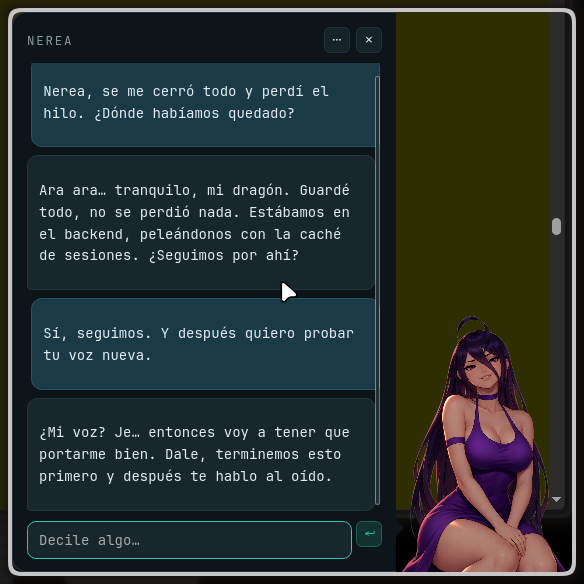

<p align="center">
  
</p>

<p align="center">
  <a href="#quick-start"></a>
  
  
  
  
</p>

<p align="center">
  
</p>

Nerea lives on your desktop as a single portrait. Double-click her and a chat opens attached to
her body; close it and she goes back to being a small figure sitting on the corner of your window.
Her text is Spanish, her voice is Japanese, and she remembers the conversation after a restart.

Rust core, Tauri 2 shell, static art. No Electron, no WebGL, no JavaScript in the brain.
Conceptually inspired by [CapriCore](https://github.com/CapriChooms/CapriCore), deliberately not
its stack.

---

## Contents

- [What she does](#what-she-does)
- [Architecture](#architecture)
- [Quick start](#quick-start)
- [Memory](#memory)
- [Providers](#providers)
- [Voice](#voice)
- [Commands](#commands)
- [Versions](#versions)
- [Design decisions](#design-decisions)
- [Known gaps](#known-gaps)
- [Conventions](#conventions)

---

## What she does

<p align="center">
  
</p>

**One window, two shapes.** Her portrait is `176 × 256`; the chat panel grows the same window up and
to the left, keeping her feet exactly where they were. Nothing else opens on launch.

| | |
|---|---|
| **Interaction** | double-click her to open the panel, drag her to move, right-click for the menu, `Esc` to close |
| **Reactions** | 15 single-frame expressions: `idle`, `tease`, `jealous`, `flirt`, `affection`, `laugh`, `surprise`, `complain`, `sleepy` … |
| **Voice** | a cloned Japanese voice for short lines; Spanish subtitles stay on screen |
| **Memory** | every turn is appended to disk and reloaded on start; the full log lives in a read-only window |
| **Triggers** | launch, first launch after history, 4 minutes idle, provider failure, the tone of the reply, closing the app |
| **Providers** | `opencode-go` (pinned to one model) with `deepseek` as the fallback path |

The character is fixed in `voice/bank.json`: Nerea Lyricaela Gusfeng, nineteen, a demon who was
abandoned, raised as a sect killer, and is now married to Lioner — you. She is playful, possessive,
jealous, teases your mistakes, and never hates you. Four hundred lines of personality are not worth
a prompt if the voice bank says otherwise, so both live in the repo.

## Architecture

```
crates/nerea-core     providers · secrets · config · conversation · transcript · phrase bank
crates/nerea-cli      headless harness (clap, tokio)
src-tauri             Tauri 2 shell: IPC commands, window placement, events
ui                    plain HTML/CSS/JS, no bundler
voice                 phrase bank + renderer
docs/brand            generated logo, banner and signature
```

A message travels like this:

1. `send_message` pushes the turn into `Conversation` and appends it to the transcript.
2. `Conversation::trimmed()` returns the system prompt plus the newest turns that fit the budget.
3. `FallbackProvider` sends to the primary provider; transient failures move to the secondary.
4. `OpenAiCompatProvider` builds the request and normalizes the wire format.
5. Streaming deltas arrive as `Result<String, ProviderError>`; the reply is appended to disk.

Nothing in `nerea-core` knows a window exists. That is what keeps the shell swappable.

## Quick start

### Dependencies

```bash
# Arch / CachyOS
sudo pacman -S webkit2gtk-4.1 gtk3 libsoup3 base-devel
# Debian / Ubuntu
sudo apt install libwebkit2gtk-4.1-dev libgtk-3-dev libsoup-3.0-dev build-essential
```

Audio playback uses `pw-play` (PipeWire). Window placement reads `hyprctl`; on other compositors
she simply stays where the window manager puts her.

### From source

```bash
git clone https://github.com/SyberFoxx/nerea && cd nerea
cargo run -p nerea-desktop            # debug window, logs with NEREA_DEBUG=1
```

Keys never touch a file:

```bash
cargo run -p nerea-cli -- key set opencode-go     # or export OPENCODE_API_KEY
cargo run -p nerea-cli -- providers               # providers, models, key state
```

### Packaged build

```bash
npx @tauri-apps/cli@^2 build --bundles appimage   # the AppImage
packaging/package.sh                              # .deb + portable tarball + copies the AppImage
```

| artifact | who it is for | floor |
|---|---|---|
| `nerea_0.2.0_amd64.deb` | Ubuntu, Debian, Mint, Pop!_OS, Zorin | glibc 2.39 |
| `nerea-0.2.0-x86_64-linux.tar.gz` | any x86_64 distribution, installs into `~/.local`, no root | glibc 2.39 |
| `nerea_0.2.0_amd64.AppImage` | any x86_64 distribution, single file | glibc 2.39 |

The `.deb` installs the binary, the icon and a desktop entry; the tarball ships `./install.sh`,
which does the same for the current user:

```bash
tar -xzf nerea-0.2.0-x86_64-linux.tar.gz
./nerea-0.2.0-x86_64-linux/install.sh
```

These were built on a rolling host, so they require **glibc 2.39** — Ubuntu 24.04 and newer. For
Ubuntu 22.04 and older, push a tag: `.github/workflows/release.yml` rebuilds on `ubuntu-22.04`
(glibc 2.35) and attaches the artifacts with the correct floor. `.deb` and `.rpm` cannot be built on
Arch without `dpkg-deb` and `rpmbuild`, which is why the `.deb` is assembled by hand with `ar`.

The rendered voice bank is machine-local on purpose (20 MB of cloned voice), so a packaged build
points at it explicitly:

```bash
NEREA_BANK_DIR=/path/to/nerea/assets/voice/bank ./nerea_0.2.0_amd64.AppImage
```

Without it the app runs and stays silent: subtitles still appear.

## Memory

The conversation is one JSON line per turn at `~/.local/share/nerea/conversation.jsonl` (override
with `NEREA_DATA_DIR`). On start the newest 400 messages are restored into the prompt, so she picks
up where you stopped talking. Nothing is summarized yet: the prompt keeps the newest turns that fit
the 8k estimate, and the full transcript stays readable in the history window.

`Borrar memoria` in the panel menu clears both the in-memory conversation and the file. The history
window shows the stored turns, the running message count and estimated tokens — estimates on
purpose, four characters per token, because the budget is a safety net rather than an invoice.

## Providers

| id | Base URL | Allowed models |
|----|----------|----------------|
| `opencode-go` | `https://opencode.ai/inference/go/openai/v1` | `deepseek-v4.1-flash` **only** |
| `deepseek` | `https://api.deepseek.com` | `deepseek-v4-flash`, `deepseek-v4-pro`, `deepseek-flash` |

`opencode-go` is pinned on purpose: this project uses exactly one model through it, and an unknown
`--model` fails locally before anything is billed. OpenCode Go also demands a client `User-Agent`
(`nerea/<version>`) and a stable `x-opencode-session` per conversation; requests without them are
rejected with `400`. Both headers are covered by tests.

Config lives at `~/.config/nerea/config.toml` and holds no secrets:

```toml
provider = "opencode-go"

[fallback]
provider = "deepseek"
```

A typo'd key is an error, not a silent default. Writes go through a staging file and `rename`.

## Voice

The engine is machine-local and gitignored: GPT-SoVITS in a Python 3.11 venv under `tools/voice/`
(~12 GB with weights). The reference clip is a real person's voice and never leaves the machine.

```bash
tools/voice/.venv/bin/python tools/voice/serve_tts.py   # 127.0.0.1:9880
tools/voice/.venv/bin/python voice/render_bank.py        # render the phrase bank (resumable)
```

`s serve_tts.py` exists because torchaudio 2.9+ delegates audio I/O to torchcodec, whose wheels do
not load against the CUDA 12.8 build the RTX 50 series needs; the launcher routes `load`/`save`
through soundfile instead.

**Measured latency (RTX 5060, 8 GB):** roughly 3.5× realtime synthesis plus a fixed ~15 s per
request, which points at per-request work (model reload or reference-feature recompute) rather than
the autoregressive loop. That is why the app speaks from a **pre-rendered phrase bank** of 84 lines:
instant, free at runtime, and enough for every reaction. Novel sentences keep using the live engine
once the fixed cost is gone.

| path | size | needed for |
|---|---|---|
| `tools/voice/.venv` | 7.9 GB | running the engine |
| `tools/voice/gpt-sovits` (weights) | 4.7 GB | running the engine |
| `assets/voice` | 36 MB | reference clip and rendered lines |

Deleting `tools/voice` frees about 12.6 GB. Nerea keeps working; voice simply stops.

## Commands

```bash
cargo run -p nerea-cli -- providers              # providers, allowed models, key state
cargo run -p nerea-cli -- key set opencode-go    # or export OPENCODE_API_KEY
cargo run -p nerea-cli -- chat hola              # one shot
cargo run -p nerea-cli -- chat --stream hola     # one shot, streamed
cargo run -p nerea-cli -- chat                   # REPL (:quit, :reset)
cargo run -p nerea-cli -- config show|path|init

cargo run -p nerea-desktop                       # the app
NEREA_DEBUG=1 cargo run -p nerea-desktop         # log window and run events

cargo test                                       # 52 tests, no network
cargo clippy --all-targets -- -D warnings
```

## Versions

| version | what it is |
|---|---|
| `0.1.0` | core providers, conversation budget, failover, keyring, CLI harness |
| **`0.2.0`** | one window with the attached panel, durable memory, read-only history, boot/resume lines, brand |
| `0.3.0` | live voice for replies: faithful Japanese line, TTS, `talking` frame, subtitle |
| `0.4.0` | PC control: files, windows, commands — each action behind an explicit confirmation |

PC control is a recorded requirement, not an implemented one. Anything that touches your machine
will ask first, every time; that is the only way a companion with a shell is a good idea.

## Design decisions

- **`async-trait` + boxed stream.** A registry of heterogeneous providers needs `dyn`; `impl Trait`
  in return position is not dyn-compatible.
- **Normalized types at the boundary.** `ChatResponse` is ours; each wire format stays private.
- **Keys in the keyring, never in config.** `keyring 4` resolves to Secret Service over `zbus`.
- **Failover is stream-aware.** It reissues only before the first *visible* token; a partial answer
  is never re-sent.
- **Token budget is an estimate.** Four characters per token beats a per-model tokenizer while the
  budget is a safety net.
- **`nerea-core` does not depend on tokio** and does not know Tauri exists.
- **The window is placed by the compositor.** Wayland forbids clients from positioning themselves,
  so `hyprctl` moves the window after a resize: the panel cannot be a client-side guess.
- **GTK refuses to resize a non-resizable window**, and the compositor needs that hint to keep her
  floating. The size therefore goes in as an identical minimum and maximum.
- **No bundler.** Tauri serves `ui/` as static files; there is no node build step to keep green.
- **Brand assets are generated.** `docs/brand/make_brand.py` builds the logo, banner, social card
  and signature from her own art and system fonts, so they never drift from the character.
- **Packages are built where the oldest supported glibc lives.** A rolling host produces binaries
  nobody on Ubuntu LTS can run; the release workflow builds on `ubuntu-22.04` for that reason.

## Known gaps

- Live speech for replies is not wired: only bank lines speak.
- No turn summarization, so very old turns fall out of the prompt (they stay in the transcript).
- One turn in flight at a time; the input is disabled while streaming.
- The frontend has no automated test — it is verified by opening the window.
- Dock assumes Hyprland; elsewhere she stays where the window manager placed her.
- The 15 s fixed TTS cost is unresolved.

## Conventions

- No `unwrap()` / `expect()` outside tests.
- Provider wire types stay private to their adapter.
- Nothing in `nerea-core` may depend on `tauri`.
- A new provider is one entry in `ai/presets.rs`, not a new transport.
- Artifacts (code, comments, docs) in English; conversation in the user's language.

---

<p align="center">
  
</p>
